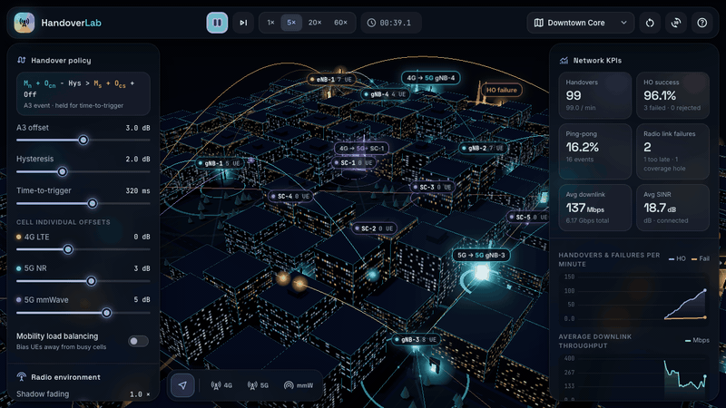
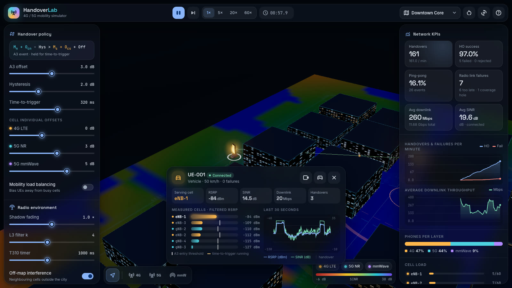
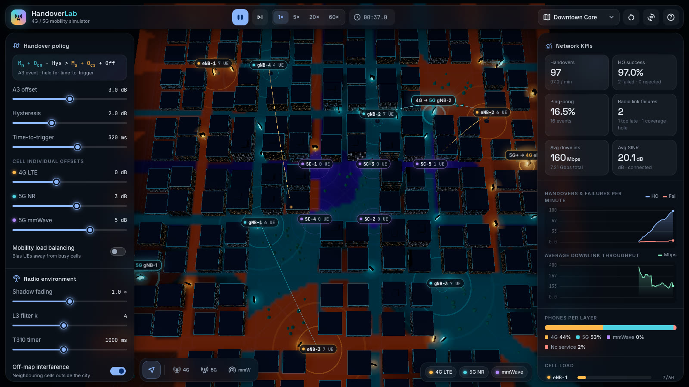
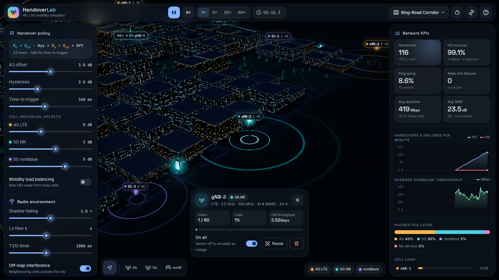
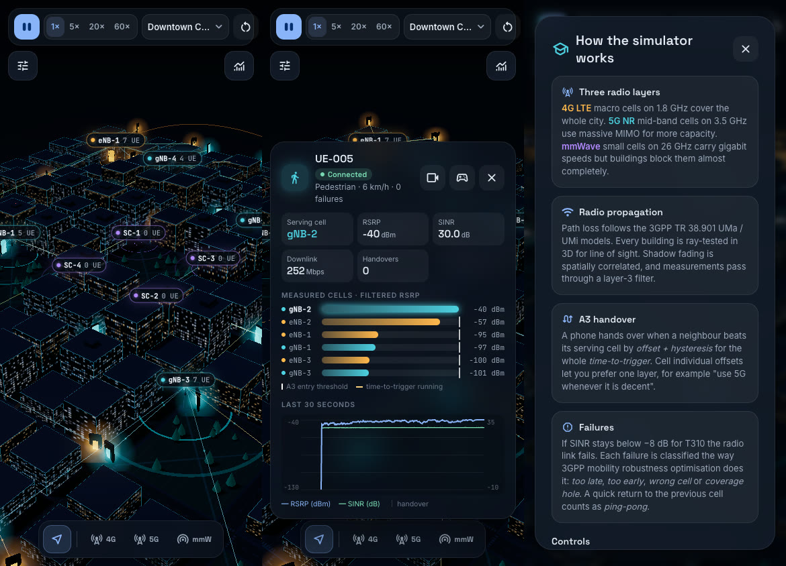

<div align="center">

# HandoverLab · 5G Mobile Network Handover Simulator

**An interactive 3D simulation of a mobile network where virtual phones move through a city and hand over between 4G LTE, 5G NR and 5G mmWave cells.**

[**▶ Live demo**](https://subzero-005.github.io/5g-handover-simulator/) · [How it works](#how-the-simulation-works) · [Run locally](#getting-started) · [Headless runner](#headless-experiments)



</div>

---

## Highlights

- **A real radio model, not just animation.** Path loss follows 3GPP TR 38.901 UMa/UMi, every building is ray-tested in 3D for line of sight, shadow fading is spatially correlated, and SINR includes co-channel interference that scales with cell load.
- **The 3GPP A3 handover procedure.** Offset, hysteresis, time-to-trigger, cell individual offsets, L3 measurement filtering, X2/Xn preparation and user-plane interruption are all modelled.
- **Failure analysis.** Radio-link monitoring uses Qout/Qin and T310. Every failure is classified as *too late*, *too early*, *wrong cell*, *coverage hole* or *cell outage*, the way mobility robustness optimisation (MRO) does it. Ping-pong is detected too.
- **Fully interactive.** Drag towers around, drop new eNBs/gNBs/small cells (on a building they become rooftop sites), take a cell off air to simulate an outage, or take control of a phone and walk it out of coverage yourself.
- **Live analytics.** KPI cards, handover and throughput trends, per-layer user share, per-cell load and a clickable signalling log.
- **A phone inspector.** It shows every measured cell, the exact A3 entry threshold for each neighbour, a live time-to-trigger progress bar, and the last 30 s of RSRP/SINR with handover markers.
- **Coverage maps.** Best-serving cell, SINR or RSRP is painted onto the ground and recomputed progressively when you change the network.
- **No build step.** Plain ES modules plus Three.js from a CDN. The simulation engine has no dependency on the renderer, so it also runs headless in Node for experiments and tests.

| Phone inspector with SINR map | Best-serving-cell coverage map |
| :---: | :---: |
|  |  |
| **Ring-road scenario, cell details** | **Responsive layout** |
|  |  |

## Getting started

Any static file server works. The repo ships a zero-dependency one:

```bash
git clone https://github.com/Subzero-005/5g-handover-simulator.git
cd 5g-handover-simulator
npm start            # → http://localhost:5173
```

You need Node 20+ for the dev server, tests and headless runner. The app itself only needs a browser with WebGL.

### Controls

| Action | How |
| --- | --- |
| Inspect a phone or cell | Click it (or click a row in the cell list / signalling log) |
| Move a cell | Drag it with the select tool |
| Add a cell | Pick 4G / 5G / mmW in the bottom toolbar, then click the map |
| Simulate an outage | Select a cell → toggle **On air**, or press <kbd>Delete</kbd> to decommission it |
| Drive a phone | Select it → 🎮 **Take control**, then <kbd>W</kbd><kbd>A</kbd><kbd>S</kbd><kbd>D</kbd> (hold <kbd>Shift</kbd> for car speed) |
| Pause / speed | <kbd>Space</kbd>, <kbd>1</kbd>–<kbd>4</kbd> for 1× / 5× / 20× / 60× |
| Cycle coverage map | <kbd>M</kbd> |
| Follow selected phone | <kbd>F</kbd> |

### Scenarios

| Scenario | What it stresses |
| --- | --- |
| **Downtown Core** | Mixed 3-layer grid around a central plaza; pedestrians, cars and ring-road traffic |
| **Ring-Road Corridor** | 60% of phones circling the city at up to 120 km/h; time-to-trigger and ping-pong behaviour |
| **Stadium District** | Dense street-level mmWave grid for a pedestrian crowd, with an LTE/NR umbrella |

## How the simulation works

```
┌────────────────────────── src/sim (pure JS, no DOM) ──────────────────────────┐
│ city.js       procedural street grid, buildings, parks, road graph, 3D LOS    │
│ radio.js      TR 38.901 path loss, RSRP per RE, noise, SINR, throughput       │
│ ue.js         mobility (street walk / drive / ring road / manual), history    │
│ network.js    100 ms tick: measure → load → RLM → A3 → HO execution → KPIs    │
│ scenarios.js  tower layouts, traffic mix, per-scenario parameters             │
└───────────────────────────────────────────────────────────────────────────────┘
          ▲ events (handover-start/complete/failed, rlf, tower-*, sample)
┌─────────┴──── src/render (Three.js) ────┐   ┌──────── src/ui (DOM) ────────┐
│ world.js     scene, camera, picking     │   │ ui.js      panels, KPIs, log │
│ city-view.js buildings, ground, trees   │   │            inspector, tools  │
│ tower-view   masts, pulses, domes       │   │ charts.js  canvas charts     │
│ phone-view   phones, cars, link layer   │   └──────────────────────────────┘
│ effects.js   signalling arcs, bursts    │
│ heatmap.js   progressive coverage map   │
└─────────────────────────────────────────┘
```

### Radio layers

| Layer | Band | Tx power | Antenna gain | Bandwidth | MIMO | Model | Building loss |
| --- | --- | --- | --- | --- | --- | --- | --- |
| 4G LTE eNB | B3 · 1.8 GHz | 46 dBm | 15 dBi | 20 MHz | 2×2 | UMa | — |
| 5G NR gNB | n78 · 3.5 GHz | 46 dBm | 24 dBi | 100 MHz | 4×4 | UMa | 4 dB / building |
| 5G mmWave SC | n258 · 26 GHz | 33 dBm | 30 dBi | 400 MHz | 2×2 | UMi street canyon | 18 dB / building |

**Per tick (100 ms), for every phone:**

1. **Mobility.** Pedestrians walk the sidewalks and pause at corners, cars stop at "traffic lights", and ring-road traffic loops the perimeter.
2. **Measurement.** RSRP is `P_tx + G − 10·log10(12·N_RB) − PL − body loss − shadowing + noise`. A 3D ray decides LOS/NLOS for each tower: a building blocks the link when it is taller than the ray where the ray crosses it. Shadowing is a Gudmundson AR(1) process using each layer's decorrelation distance. Results are smoothed with the TS 38.331 layer-3 filter `F = (1−a)F + aM`, `a = 1/2^(k/4)`.
3. **Link quality.** SINR comes from serving RSRP over same-layer interferers (weighted by their load), interference from cells off the map, and thermal noise. It is capped at 30 dB by receiver impairments. Throughput is an attenuated, truncated Shannon bound with SINR-dependent MIMO rank, shared round-robin across the cell's users.
4. **Radio-link monitoring.** T310 starts when SINR drops below Qout (−8 dB) and stops above Qin (−6 dB). If it expires, a radio link failure (RLF) is declared and the phone re-establishes on the best cell.
5. **A3 evaluation.** `Mn + Ocn − Hys > Ms + Ocs + Off` must hold continuously for time-to-trigger. Optional mobility load balancing lowers the CIO of busy cells.
6. **Handover execution.** Admission control is checked first, then X2/Xn preparation runs while the source still serves, then a user-plane interruption follows (25–70 ms depending on intra-NR, intra-LTE, inter-frequency or inter-RAT). The handover fails if the target SINR is too low on arrival.

### Tuning trade-off (headless, 10 simulated minutes)

Results from `npm run sim -- --scenario <s> --minutes 10 --ttt <ms> --hys <dB> --offset <dB>`:

| Scenario | TTT / Hys / Offset | Handovers | Ping-pong | RLFs | Avg DL |
| --- | --- | ---: | ---: | ---: | ---: |
| Downtown | 100 ms / 0 dB / 0 dB (aggressive) | 4549 | 42.9% | 2 | 338 Mbps |
| Downtown | 320 ms / 2 dB / 3 dB (default) | 1802 | 14.9% | 44 | 367 Mbps |
| Downtown | 1280 ms / 4 dB / 3 dB (conservative) | 552 | 0.5% | 426 | 175 Mbps |
| Ring road | 100 ms / 0 dB / 0 dB | 4671 | 50.5% | 0 | 487 Mbps |
| Ring road | 320 ms / 2 dB / 3 dB | 1347 | 4.6% | 0 | 445 Mbps |
| Ring road | 1280 ms / 4 dB / 3 dB | 969 | 0.1% | 66 | 439 Mbps |

This is the classic mobility-robustness trade-off. Aggressive settings ping-pong constantly. Conservative settings hand over too late, especially for mmWave links that get cut off at street corners, and throughput collapses.

## Headless experiments

```bash
npm run sim -- --scenario highway --minutes 10 --ttt 160 --hys 1
npm run sim -- --scenario stadium --ues 120 --mlb --json > result.json
npm run sim -- --help
```

The engine can also be used directly:

```js
import { Simulation } from './src/sim/index.js';

const sim = new Simulation({ scenario: 'urban', params: { tttMs: 480 } });
sim.on('rlf', ({ ue, cause }) => console.log(ue.id, cause));
sim.run(5 * 60_000);
console.log(sim.kpis());
```

In the browser, the same objects are exposed as `window.handoverLab` for poking around in the console.

## Tests

```bash
npm test
```

The suite uses Node's built-in test runner and covers:
- path-loss formulas against TR 38.901
- noise, SINR and throughput bounds
- building blockage
- the A3 / TTT state machine with synthetic measurements
- ping-pong detection, outage RLF and re-establishment, admission control
- determinism, UEs staying out of buildings, and runtime tower editing

## Project structure

```
index.html          app shell, panels, help dialog
styles.css          design tokens (Material 3 dark), glass surfaces, responsive layout
src/main.js         bootstraps simulation + renderer + UI, runs the frame loop
src/sim/            simulation engine (runs in browser and Node)
src/render/         Three.js scene, views, effects and coverage map
src/ui/             DOM controls, analytics, inspector, canvas charts
scripts/serve.js    zero-dependency static server
scripts/run-headless.js  CLI runner for experiments
tests/              node:test suites
```

## Tech

Three.js r169 (WebGL, PCF soft shadows, UnrealBloom post-processing, CSS2D labels) · vanilla ES modules · Canvas 2D charts · Node test runner · GitHub Actions + Pages.

## License

[MIT](LICENSE) © Adhiraj Madan
